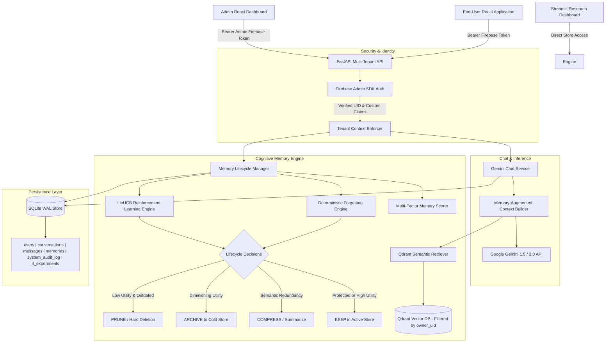

# System Architecture: Intelligent Forgetting in Agentic AI

## 1. Architectural Overview

The **Intelligent Forgetting Platform** is a full-stack, secure, multi-user AI chat application and memory research platform. It pairs Google Gemini conversational intelligence with an intelligent memory-management system that decides what an autonomous agent should **KEEP**, **COMPRESS**, **ARCHIVE**, or **PRUNE**.

The platform is designed around strict tenant isolation: every user has their own conversations, messages, and personalized long-term memories. Cross-user data leakage is strictly prevented at both the relational persistence layer and the vector database layer.

---

## 2. Component Breakdown

### 2.1 Multi-Tenant Persistent Storage Layer (`MemoryStore`)
- **Technology**: Persistent SQLite with Write-Ahead Logging (`PRAGMA journal_mode=WAL`), foreign key constraints (`PRAGMA foreign_keys = ON`), and connection-level transaction management.
- **Tables**:
  - `users`: Tracks registered user IDs, emails, display names, roles (`user`, `admin`), account status (`active`, `disabled`), and timestamps.
  - `conversations`: User-owned conversation threads with title, status, and metadata.
  - `messages`: Chronological conversation turns (`user`, `model`, `system`) with token usage.
  - `memories`: Comprehensive memory records with `user_id` ownership, access statistics, retention status (`active`, `archived`, `forgotten`, `summarized`, `permanent`), protection flags (`is_pinned`, `is_critical`), and estimated token costs.
  - `system_audit_log`: Tamper-evident audit trail logging administrative, security, and memory lifecycle events.
  - `rl_experiments`: Persisted historical metrics and benchmark runs.
- **Indexes**: Dedicated B-Tree indexes on `(user_id, retention_status)`, `(user_id, category)`, `(user_id, is_pinned)`, and `(conversation_id, created_at)`.
- **Cascading Deletion**: Supports complete user data eradication across all tables and vector collections upon account deletion.

### 2.2 Semantic Vector Memory Layer (`VectorMemoryStore`)
- **Technology**: Qdrant vector database (`qdrant-client`) paired with FastEmbed (`BAAI/bge-small-en-v1.5`, 384 dimensions, Cosine distance).
- **Tenant Isolation**: Every vector query enforces a strict payload filter `owner_uid == user_id`. Cross-user vector retrieval is impossible.
- **Payload Schema**: Canonical `memory_id`, `owner_uid`, `content`, `category`, `importance`, `retention_status`, `is_pinned`, `is_critical`, and `created_at`.
- **In-Memory Fallback**: When external Qdrant Cloud or local service is unreachable, an in-memory client seamlessly activates for development and offline testing.

### 2.3 Authentication & Authorization (`auth.py`)
- **Provider**: Firebase Authentication.
- **Backend Verification**: Firebase Admin SDK validates ID tokens, checks revocation, and verifies user status.
- **Role-Based Access Control (RBAC)**: Extracts `admin` role from Firebase Custom Claims or authorized local provisioning. Admin endpoints (`/api/v1/admin/*`) strictly reject non-admin identities.
- **Offline / Test Support**: Built-in mock token handlers for hermetic unit testing without network dependencies.

### 2.4 Gemini Chat Service (`gemini_service.py`)
- **SDK**: Official Google Gen AI SDK (`google-genai`).
- **Context Construction Pipeline**:
  1. Authenticates user and validates conversation ownership.
  2. Queries user-specific vector memories matching current task context.
  3. Formulates a structured system prompt grounding Gemini in personalized long-term memories.
  4. Appends recent conversation turn history within token budget limits.
  5. Executes model inference (supporting streaming).
  6. Evaluates interaction for candidate memories and logs operational metrics.
- **Simulation Mode**: Transparent fallback simulation if `GEMINI_API_KEY` is not provided.

### 2.5 Cognitive Memory Engine
- **Mathematical Scorer (`MemoryScorer`)**: Multi-factor utility formulation combining intrinsic importance, exponential temporal decay, logarithmic frequency saturation, task relevance, and redundancy penalties.
- **Deterministic Engine (`ForgettingEngine`)**: Implements strict threshold rules, capacity bounds, clustering summarization, and immutable safety constraints ($P(m) = 1 \implies \text{KEEP}$).
- **Reinforcement Learning Engine (`RLEngine`)**: Contextual bandit using LinUCB with upper confidence bound exploration, safety masking, and multi-objective reward balancing.

### 2.6 User & Admin Interfaces
- **End-User Application**: React 19 + TypeScript + Vite web app with clean dark mode, responsive layout, sidebar conversation management, markdown message rendering, and a dedicated memory manager.
- **Admin Dashboard**: Real-time telemetry, user management, memory lifecycle analytics, RL experiment controls, and system audit logs.
- **Streamlit Research Dashboard**: Standalone dashboard for exploratory research and parameter tuning.

